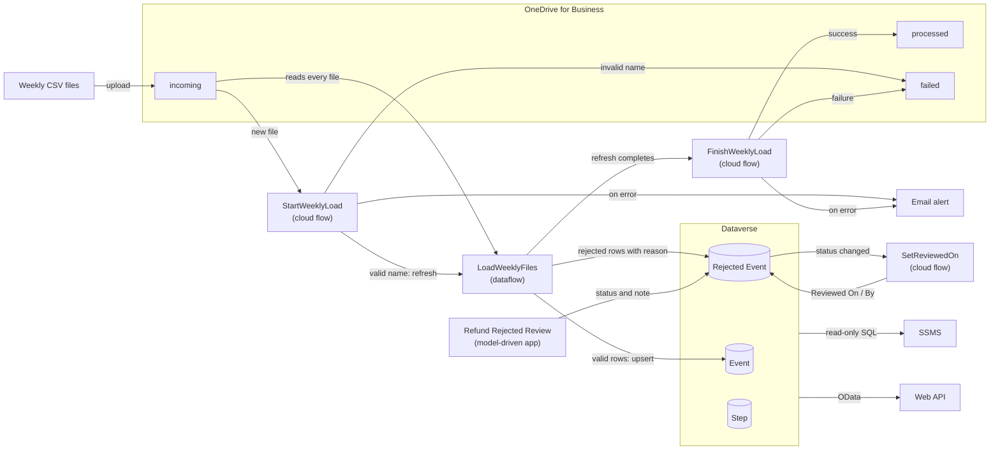
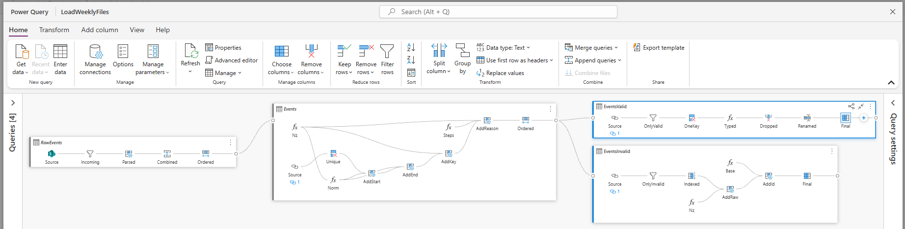
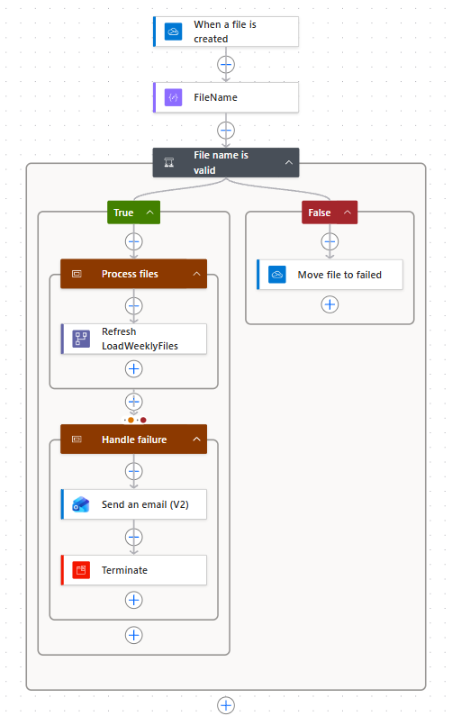
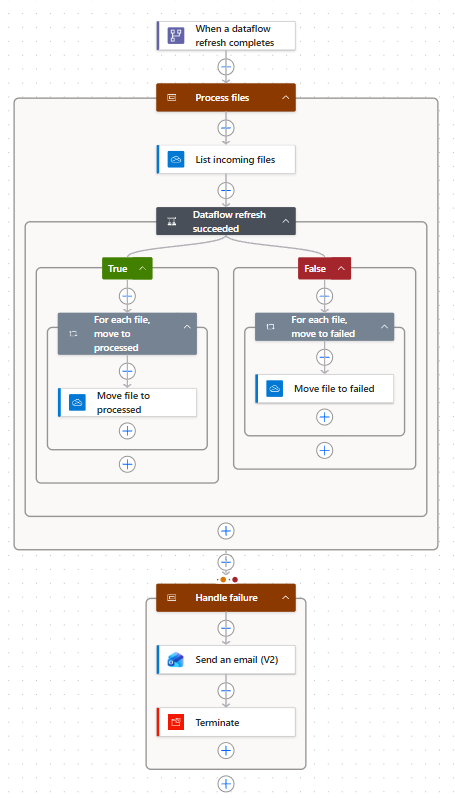
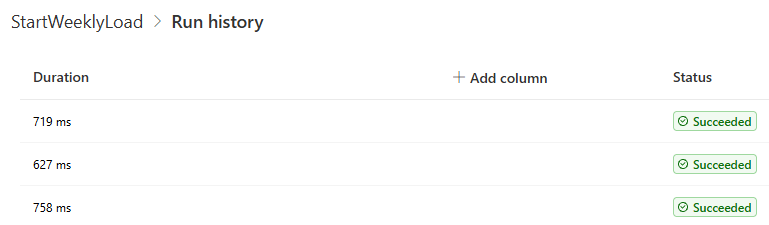
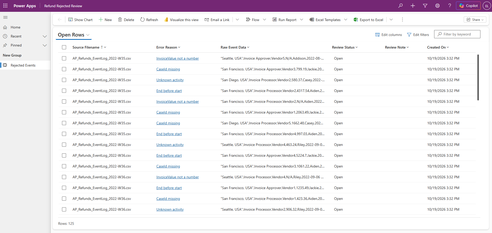
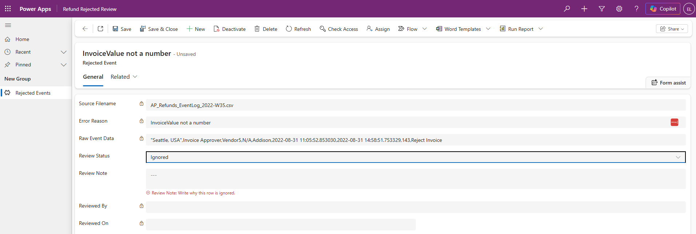
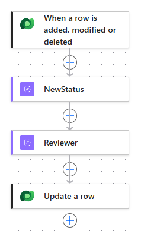

# Refund Process on Power Platform

A Power Platform solution that loads weekly refund event-log files into Dataverse, validates every row against data quality rules, and
lets a reviewer handle the rejected rows in a model-driven app.

A portfolio project for learning Power Platform. It started from an idea, not a tutorial: take a business process, load its data every
week, catch the bad rows, and let a person decide what happens to them. The solution was designed for this project and built in a
Power Platform Developer environment with Microsoft sample data.

**Built with:** Dataverse · Power Query dataflows · Power Automate · Power Apps (model-driven) · Dataverse Web API (OData) ·
SQL on the Dataverse SQL endpoint (SSMS) · Power Platform CLI

## Architecture



## Solution components

Solution `RefundProcess`, publisher prefix `rp`.

| Component | Type | Description |
|---|---|---|
| Event (`rp_event`) | Table | Valid events. Alternate key `rp_eventkey` (`CaseId\|Activity\|Start`) makes the load an upsert |
| Rejected Event (`rp_rejectedevent`) | Table | Rejected rows with the reason, the raw line, the source file and the review columns |
| Step (`rp_step`) | Table | The 13 activities of the refund process |
| `LoadWeeklyFiles` | Dataflow | Reads every file in `incoming`, removes identical lines, fixes `dd.mm.yyyy` timestamps and applies five quality rules: CaseId missing, unknown activity, unreadable timestamp, end before start, `InvoiceValue` not a number |
| `StartWeeklyLoad` | Cloud flow | New file in `incoming`: checks the file name, refreshes the dataflow, sends an alert on error |
| `FinishWeeklyLoad` | Cloud flow | Refresh completed: moves the files to `processed` or `failed`, sends an alert on error |
| `SetReviewedOn` | Cloud flow | Writes Reviewed On and Reviewed By when the Review Status of a rejected row changes |
| `Refund Rejected Review` | Model-driven app | Views of open and reviewed rows; a reviewer sets each row to `Resolved` or `Ignored` |
| `Ignored Requires A Note` | Business rule | Blocks `Ignored` without a Review Note |
| `Refund Reviewer`, `Refund Admin` | Security roles | Reviewer: read and write on rejected rows, read on the rest. Admin: full access to the three tables |
| `rp_OneDriveSiteURL` | Environment variable | Site URL of the landing folder (created, not yet used by the dataflow or the flows) |
| Connection references | | Dataverse, OneDrive for Business, Power Query Dataflows, Office 365 Outlook |

Outside the solution: a Copilot Studio agent on `Rejected Event` (in progress), read-only SQL for SSMS in `dataverse_sql/`, and DAX
measures in `powerbi/` (written, not run).

## Screenshots

**Dataflow `LoadWeeklyFiles`:** raw files, quality rules, and the split into valid and rejected rows



**Cloud flow `StartWeeklyLoad`:** file name check, refresh, and error handling with *Configure run after*



**Cloud flow `FinishWeeklyLoad`:** moves the files to `processed` or `failed` when the refresh completes



**Run history of `StartWeeklyLoad`**



**Model-driven app `Refund Rejected Review`:** the 125 rejected rows, view *Open Rows*



**Business rule:** `Ignored` without a Review Note is blocked



**Cloud flow `SetReviewedOn`:** records who reviewed a row and when



## Prerequisites

- A Power Platform environment with Dataverse (a Developer environment is enough)
- A OneDrive for Business folder `RefundProcess` with the subfolders `incoming`, `processed` and `failed`
- The *Power Query Dataflows* connector allowed by the environment's connector policy
- [Power Platform CLI](https://learn.microsoft.com/power-platform/developer/cli/introduction) (`pac`) for export, and SSMS for the load checks

## Source control

The unmanaged solution is exported and unpacked into `solution/RefundProcess` with `pac`:

```
pac solution export --name RefundProcess --path RefundProcess_unmanaged.zip --overwrite
pac solution unpack --zipfile RefundProcess_unmanaged.zip --folder solution/RefundProcess --packagetype Unmanaged
```

Personal and tenant-specific values (email address, OneDrive path and IDs, owner, tenant, user and environment IDs) are replaced with
placeholders before commit. The folder documents the solution; packing and importing it has not been tested. There is no Azure DevOps or
other pipeline. Build steps for each part are in [docs/](docs/).

## Usage

1. Upload a weekly file to `incoming`. `StartWeeklyLoad` refreshes the dataflow and `FinishWeeklyLoad` moves the file when the refresh completes.
2. Open `Refund Rejected Review`, view *Open Rows*, and set each row to `Resolved` or `Ignored` with a note.
3. Run [dataverse_sql/load_checks.sql](dataverse_sql/load_checks.sql) in SSMS against the Dataverse SQL endpoint and compare the counts
   with `data/expected_rejections.csv`.

To reload a file, delete its rows in `Rejected Event` first (Bulk deletion in the Power Platform admin center, filtered on the source file).

## Testing

Expected counts per file are computed outside the platform (`data/expected_rejections.csv`), so a load is correct only
if it matches numbers the platform did not produce. All 18 weekly files are loaded and match.

Row counts, checked with SQL in SSMS against the Dataverse SQL endpoint:

```sql
SELECT 'Event' AS TableName, COUNT(*) AS RowsLoaded FROM rp_event
UNION ALL
SELECT 'Rejected Event', COUNT(*) FROM rp_rejectedevent;
```

| TableName | RowsLoaded |
|---|---|
| Event | 19,176 |
| Rejected Event | 125 |

```sql
SELECT rp_errorreason AS Reason, COUNT(*) AS RowsRejected
FROM rp_rejectedevent
GROUP BY rp_errorreason
ORDER BY RowsRejected DESC;
```

| Reason | RowsRejected |
|---|---|
| End before start | 36 |
| CaseId missing | 35 |
| InvoiceValue not a number | 29 |
| Unknown activity | 25 |

The files also hold 36 identical lines. The load removes them before the rules run, so they are not stored in `Rejected Event`.

Also verified: the flows end to end, the business rule on the form and in bulk edit, `SetReviewedOn`, four OData queries, and Flow checker
and Solution checker with 0 issues. Not yet tested: the failure paths of the flows, the run count of
`SetReviewedOn` per change, the security roles with a second user, and the business rule in the editable grid and Excel import. Every test and its result is in [TESTS.md](TESTS.md).

## Data

Microsoft's sample event log for an accounts payable refund process (*AP Refunds*) from the
[process mining tutorial](https://learn.microsoft.com/power-automate/process-mining-tutorial), split into 18 weekly files
(`data/weekly/`) with deliberate faults. The data is for demonstration only and all names are fictitious.

## Repository structure

```
solution/        unpacked unmanaged solution (RefundProcess)
docs/            build notes for the load, flows, review app, agent and OData; screenshots/
dataverse_sql/   read-only SQL for SSMS on the Dataverse SQL endpoint
powerbi/         DAX measures
data/            weekly files, expected rejections, table samples
TESTS.md         tests with expected results
```
